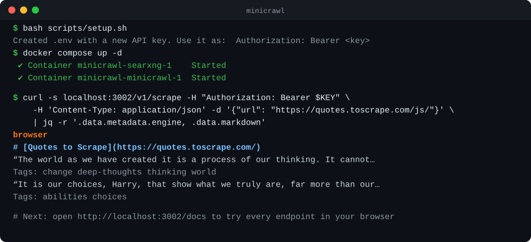
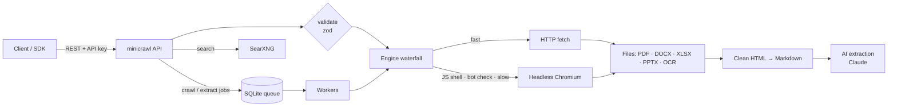

<div align="center">


### Turn any website into clean, LLM-ready data. Self-hosted, in one command.

A Firecrawl-compatible API for scraping, crawling, mapping, searching and AI extraction.<br>
It reads web pages, JavaScript apps, PDFs, Office files and images, and runs on your own machine with your own keys.

[](LICENSE)
[](https://github.com/fairoz-539/minicrawl/actions/workflows/ci.yml)
[](package.json)
[](docker-compose.yml)
[](docs/API.md#official-firecrawl-sdks)
[](CONTRIBUTING.md)

[**Quick start**](#-quick-start) ·
[**Features**](#-features) ·
[**API reference**](docs/API.md) ·
[**Integrations**](docs/INTEGRATIONS.md) ·
[**Self-hosting guide**](docs/SELF_HOSTING.md) ·
[**Teams & quotas**](docs/ADMIN.md) ·
[**Contributing**](CONTRIBUTING.md)

</div>

<p align="center">
  
</p>

---

## ✨ Why minicrawl?

AI apps, RAG pipelines and agents need web content as **clean text**, not raw HTML full of menus, ads and cookie banners. Hosted scraping APIs are great, but they cost per page, see every URL you fetch, and lock the code that does the hard work behind their cloud.

minicrawl is a **self-hosted alternative that speaks the same API as [Firecrawl](https://github.com/firecrawl/firecrawl)**, v1 and v2. Point your existing Firecrawl code and the official SDKs at your own server, keep your data on your machine, and pay nothing per page.

```bash
curl -X POST http://localhost:3002/v1/scrape \
  -H "Authorization: Bearer $API_KEY" -H "Content-Type: application/json" \
  -d '{"url": "https://example.com"}'
```

```json
{
  "success": true,
  "data": {
    "markdown": "# Example Domain\n\nThis domain is for use in documentation examples…",
    "metadata": { "title": "Example Domain", "statusCode": 200, "engine": "fetch" }
  }
}
```

## 🚀 Quick start

You need [Docker](https://docs.docker.com/get-docker/) (Docker Desktop on Windows and macOS).

```bash
git clone https://github.com/fairoz-539/minicrawl.git
cd minicrawl
bash scripts/setup.sh          # Windows: powershell -ExecutionPolicy Bypass -File scripts\setup.ps1
docker compose pull && docker compose up -d
```

1. **Setup** creates `.env` with **your own** freshly generated API key, and optionally asks for your Anthropic key (needed only for AI extraction).
2. **Docker** pulls the prebuilt image (`ghcr.io/fairoz-539/minicrawl`, amd64 and arm64) and starts minicrawl, with headless Chromium and OCR built in, plus a private [SearXNG](https://github.com/searxng/searxng) for search.
3. Open **http://localhost:3002/docs**, click **Authorize**, paste your key, and try every endpoint in the browser.

Prefer building from source? Use `docker compose up -d --build`. For servers, HTTPS, scaling out with Postgres or Kubernetes, configuration and troubleshooting, see the **[self-hosting guide](docs/SELF_HOSTING.md)**.

> [!IMPORTANT]
> **Bring your own keys.** The repository contains no keys. Every installation generates its own API key, kept only in its own `.env`, which is git-ignored and excluded from Docker builds. AI extraction uses each installer's own `ANTHROPIC_API_KEY`. The container refuses to start without a key, or with a placeholder or weak one.

## 🧩 Features

| | |
|---|---|
| 🌐 **Any page** | Fast HTTP first. It switches automatically to headless Chromium for JavaScript apps, near-empty pages and self-clearing bot checks |
| 🧹 **Clean output** | Main content only (no nav, footers, ads or cookie banners), as markdown with tables and code languages, in the correct character encoding |
| 📄 **Files** | PDF (text layer + OCR for scans), Word, Excel (a table per sheet), PowerPoint (slides and notes), images. OCR runs offline with [light-ocr](https://github.com/arcships/light-ocr) |
| 🖱️ **Browser actions** | `click`, `write`, `press`, `wait`, `scroll`, `screenshot`, `scrape`, `executeJavascript`: log in, search, press "load more", then capture |
| 📸 **Screenshots** | Viewport or full page, as PNG |
| 🕸️ **Crawl** | Whole sites: robots.txt, sitemaps, include/exclude regexes, depth and page limits, dedupe of URL variants and redirects, webhooks |
| 🗺️ **Map** | A site's URLs in seconds, ranked by relevance to a search term |
| 🔎 **Search** | Web search through a bundled private SearXNG; optionally scrape every result |
| 🤖 **AI extraction** | Give a JSON Schema and/or a prompt and get structured data back, from one page or a whole site, via Claude structured outputs |
| 🧠 **MCP for AI agents** | A built-in MCP server (`/mcp`) gives Claude Code, Cursor, VS Code and Claude Desktop scrape, crawl, map, search and extract tools |
| 🦜 **RAG frameworks** | Python client with a **LangChain** loader and a **LlamaIndex** reader |
| 🛡️ **Proxies** | Bring-your-own basic and stealth pools; blocked requests retry through stealth automatically |
| 🔐 **Secure defaults** | Required API keys (several per server), SSRF protection, non-root container, health checks |
| 🪶 **Lightweight** | One container plus SearXNG, with SQLite storage. No Redis, Postgres or message queue |
| 🏢 **Teams and quotas** | Per-team API keys (hashed), roles and scopes, quotas and rate limits, usage metering, zero data retention, IP allowlists, domain policies, and an audit log you can stream to a SIEM |
| 📈 **Scales out** | Optional Postgres scale mode: separate API and worker containers, with Docker Compose or a Helm chart |
| 📘 **Documented** | Interactive `/docs` (OpenAPI), full API reference, and a self-hosting guide |

## 🔌 API at a glance

| Method | Endpoint | Description |
|---|---|---|
| `POST` | [`/v1/scrape`](docs/API.md#post-v1scrape) | Scrape one URL: page, PDF, Office file or image |
| `POST` | [`/v1/crawl`](docs/API.md#crawl) | Crawl a site (async); check it with `GET /v1/crawl/{id}` |
| `POST` | [`/v1/map`](docs/API.md#post-v1map) | List a site's URLs |
| `POST` | [`/v1/search`](docs/API.md#post-v1search) | Search the web, optionally scraping each result |
| `POST` | [`/v1/extract`](docs/API.md#extract) | AI extraction across pages (async); get it with `GET /v1/extract/{id}` |
| `POST` | [`/v1/batch/scrape`](docs/API.md#batch-scrape) | Scrape a list of URLs (async) |
| | [`/v2/*`](docs/API.md#firecrawl-v2-api) | All of the above in Firecrawl's v2 shapes, for the SDKs' default clients |
| `GET` | [`/health`](docs/API.md#health-and-discovery) | Status and which features are enabled |
| `GET` | `/docs` · `/openapi.json` | Interactive explorer · OpenAPI spec |

Also: `GET /v1/crawl/{id}/errors`, `DELETE /v1/crawl/{id}`, and `POST /mcp` for AI agents. Teams, keys, usage and the audit log live under [`/admin/v1`](docs/ADMIN.md). See the **[full API reference](docs/API.md)** for every option, response and error code.

## 🤖 Integrations

**Give your AI agent the web.** minicrawl is an MCP server, so you can connect it in one line:

```bash
# Claude Code
claude mcp add --transport http minicrawl http://localhost:3002/mcp --header "Authorization: Bearer $API_KEY"
```

```jsonc
// Cursor: ~/.cursor/mcp.json
{ "mcpServers": { "minicrawl": { "url": "http://localhost:3002/mcp", "headers": { "Authorization": "Bearer YOUR_KEY" } } } }

// Claude Desktop: claude_desktop_config.json (via the minicrawl-mcp bridge)
{ "mcpServers": { "minicrawl": { "command": "npx", "args": ["-y", "minicrawl-mcp"],
  "env": { "MINICRAWL_API_URL": "http://localhost:3002", "MINICRAWL_API_KEY": "YOUR_KEY" } } } }
```

**Feed your RAG pipeline** with LangChain or LlamaIndex:

```python
from minicrawl.langchain import MinicrawlLoader        # pip install "minicrawl-py[langchain]"
docs = MinicrawlLoader("https://docs.example.com", mode="crawl", params={"limit": 50}).load()
```

VS Code, LlamaIndex, Firecrawl SDKs, n8n and more are covered in **[docs/INTEGRATIONS.md](docs/INTEGRATIONS.md)**.

## 💡 Examples

<details open>
<summary><b>Scrape a JavaScript-rendered page to markdown</b></summary>

```bash
curl -X POST http://localhost:3002/v1/scrape \
  -H "Authorization: Bearer $API_KEY" -H "Content-Type: application/json" \
  -d '{"url": "https://quotes.toscrape.com/js/", "formats": ["markdown", "links"]}'
```
</details>

<details>
<summary><b>Drive the page: search Wikipedia, then screenshot</b></summary>

```bash
curl -X POST http://localhost:3002/v1/scrape \
  -H "Authorization: Bearer $API_KEY" -H "Content-Type: application/json" -d '{
  "url": "https://en.wikipedia.org/wiki/Main_Page",
  "formats": ["markdown", "screenshot"],
  "actions": [
    {"type": "write", "selector": "input[name=search]", "text": "Web scraping"},
    {"type": "press", "key": "Enter"},
    {"type": "wait", "selector": "#firstHeading"}
  ]}'
```
</details>

<details>
<summary><b>Crawl a site (Python)</b></summary>

```python
import time, requests

BASE, H = "http://localhost:3002", {"Authorization": "Bearer YOUR_KEY"}

job = requests.post(f"{BASE}/v1/crawl", headers=H,
                    json={"url": "https://books.toscrape.com", "limit": 20, "crawlEntireDomain": True}).json()
while (status := requests.get(f"{BASE}/v1/crawl/{job['id']}", headers=H).json())["status"] == "scraping":
    time.sleep(2)

for page in status["data"]:
    print(page["metadata"]["url"], len(page["markdown"]))
```
</details>

<details>
<summary><b>Extract structured data with AI (JavaScript)</b></summary>

```js
const res = await fetch("http://localhost:3002/v1/scrape", {
  method: "POST",
  headers: { Authorization: "Bearer YOUR_KEY", "Content-Type": "application/json" },
  body: JSON.stringify({
    url: "https://books.toscrape.com/catalogue/a-light-in-the-attic_1000/index.html",
    formats: ["json"],
    jsonOptions: {
      schema: {
        type: "object",
        properties: { title: { type: "string" }, price: { type: "string" }, in_stock: { type: "boolean" } },
        required: ["title", "price"],
      },
    },
  }),
});
console.log((await res.json()).data.json); // { title: "A Light in the Attic", price: "£51.77", in_stock: true }
```
</details>

<details>
<summary><b>Use the official Firecrawl SDK</b></summary>

```js
import { FirecrawlAppV1 } from "@mendable/firecrawl-js";

const app = new FirecrawlAppV1({ apiKey: "YOUR_KEY", apiUrl: "http://localhost:3002" });
const page = await app.scrapeUrl("https://example.com", { formats: ["markdown"] });
const site = await app.crawlUrl("https://books.toscrape.com", { limit: 10 });
```

Tested methods: `scrapeUrl`, `mapUrl`, `crawlUrl`, `asyncCrawlUrl`, `checkCrawlStatus`, `checkCrawlErrors`, `cancelCrawl`, `search`, `asyncExtract`.
</details>

PowerShell examples and every option are in the **[API reference](docs/API.md#calling-it-from-code)**.

## ⚖️ minicrawl vs. Firecrawl

| | minicrawl | Firecrawl (open source) | Firecrawl (cloud) |
|---|:---:|:---:|:---:|
| scrape · crawl · map · search · extract | ✅ | ✅ | ✅ |
| Firecrawl v1 API | ✅ | ✅ | ✅ |
| Firecrawl v2 API and batch scrape | ✅ | ✅ | ✅ |
| JS rendering, actions, screenshots | ✅ | ✅ | ✅ |
| PDF / Office / image OCR | ✅ offline | partial | ✅ |
| Services to run | 2 containers (API, workers and Postgres to scale out) | API, workers, Postgres, Redis, RabbitMQ, Playwright | – |
| Interactive API docs (`/docs`) | ✅ | – | ✅ (website) |
| Teams, per-team keys, quotas, usage, audit log | ✅ | – | ✅ |
| Anti-bot network (stealth fleet, residential proxies) | bring your own proxies | – | ✅ |
| Deep research, agent, change monitoring | – | ✅ | ✅ |
| Cost | free, your hardware | free, your hardware | per page |

minicrawl is not affiliated with Firecrawl. It is an independent, simpler implementation of the same API idea.

## 🏗️ How it works



- **Engine waterfall:** a fast HTTP fetch runs first. When the result is a JavaScript shell, a bot-check page or an error, or the fetch is slow, Chromium starts and the best result wins.
- **Crawling:** a SQLite-backed job queue with lock heartbeats and a reaper. Workers seed from robots.txt and sitemaps, extract links, filter them, deduplicate URL variants, and enqueue.
- **Docs that can't drift:** request validation and the OpenAPI spec are generated from the same schemas.

<details>
<summary>Project structure</summary>

```
minicrawl/
├── src/
│   ├── server.js        HTTP API, auth, errors, /health
│   ├── api.js           The operations behind every endpoint (shared by REST and MCP)
│   ├── mcp.js           MCP server for AI agents (POST /mcp)
│   ├── schemas.js       Request schemas (validation + OpenAPI source)
│   ├── openapi.js       /openapi.json and /docs
│   ├── engines.js       Fetch/browser waterfall and result judging
│   ├── browser.js       Playwright: rendering, actions, screenshots, downloads
│   ├── documents.js     PDF, DOCX, XLSX, PPTX, images
│   ├── ocr.js           light-ocr (GPU with CPU fallback)
│   ├── html.js          Main-content cleaning, metadata, links
│   ├── markdown.js      HTML → markdown
│   ├── crawler.js       Crawl rules, robots.txt, sitemaps, URL dedupe
│   ├── worker.js        Crawl and extract jobs
│   ├── db.js            SQLite job queue and storage
│   ├── map.js · search.js · llm.js · proxy.js · url-guard.js · webhook.js
├── test/                End-to-end tests (fixture site, mock services)
├── docs/                API reference, self-hosting guide
├── deploy/searxng/      Bundled SearXNG settings
├── integrations/
│   ├── mcp/             minicrawl-mcp: stdio MCP bridge (Claude Desktop)
│   └── python/          Python client + LangChain loader + LlamaIndex reader
├── scripts/             setup.sh / setup.ps1 (generate your .env)
├── Dockerfile · docker-compose.yml
```
</details>

## 🛠️ Development

You need Node.js 22.13+ (24 recommended).

```bash
npm install
npx playwright install chromium   # once
npm start                         # http://localhost:3002 (reads .env)
npm test                          # end-to-end tests: fixture site, mock Claude, mock proxy
```

See **[CONTRIBUTING.md](CONTRIBUTING.md)** for the workflow and conventions.

## 🗺️ Roadmap

- [x] Prebuilt multi-arch Docker image on GHCR (1.1)
- [x] Scale mode: Postgres, separate API and worker containers, Helm chart (1.2)
- [x] Teams, hashed API keys, quotas, usage metering, audit log (1.3)
- [x] Firecrawl v2 API and batch scrape, tested with the official SDKs (1.4)
- [ ] Page cache (`maxAge`) and local AI (OpenAI-compatible APIs, Ollama)
- [ ] Change monitoring (diff pages between checks, with notifications)
- [ ] Persistent browser sessions
- [ ] Web dashboard with SSO
- [ ] Prometheus metrics and OpenTelemetry tracing

Ideas and votes are welcome in [issues](https://github.com/fairoz-539/minicrawl/issues).

## 🤝 Contributing

Contributions are welcome: bug reports, docs fixes, new features. Please read **[CONTRIBUTING.md](CONTRIBUTING.md)** and our **[Code of Conduct](CODE_OF_CONDUCT.md)**. For security issues, follow **[SECURITY.md](SECURITY.md)** instead of opening a public issue.

## ⚠️ Responsible use

Respect websites' terms of service and robots.txt (honored by default), and don't overload sites you don't own: keep `WORKERS` low and use `limit`. minicrawl does not solve CAPTCHAs or spoof browser fingerprints; sites that require them return `403 BLOCKED_BY_SITE`.

## 📄 License and acknowledgements

minicrawl is licensed under the **[GNU AGPL-3.0](LICENSE)**. If you run a modified version as a network service, the AGPL requires you to offer its source code to that service's users.

- **[Firecrawl](https://github.com/firecrawl/firecrawl)** (AGPL-3.0). minicrawl follows its API and design and ports a few parts: the list of non-content selectors, the URL-deduplication rules, and the engine-waterfall approach.
- **[light-ocr](https://github.com/arcships/light-ocr)** for offline OCR. **[Playwright](https://playwright.dev)** for the browser. **[SearXNG](https://github.com/searxng/searxng)** for search. **[Turndown](https://github.com/mixmark-io/turndown)** for markdown.

<div align="center">

**If minicrawl is useful to you, consider giving it a ⭐**

</div>
